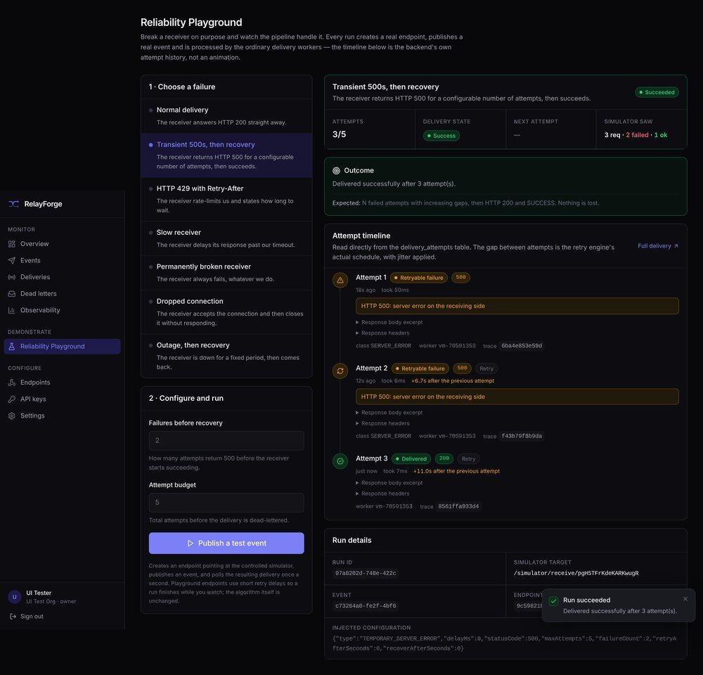

# RelayForge

**Reliable event delivery infrastructure for applications that cannot afford to
lose events.**

RelayForge accepts your events in a single database transaction, delivers them
to signed webhook endpoints through Kafka-backed workers, retries failures with
exponential backoff and jitter, and keeps every attempt as evidence — so a
delivery that fails is something you can inspect and replay, not something you
discover from a customer.

```
Java 21 · Spring Boot 3.5 · PostgreSQL 16 · Apache Kafka · Redis 7
Next.js 15 · React 19 · TypeScript · Tailwind CSS
Prometheus · Grafana · OpenTelemetry · Docker
```

---

## The problem

A webhook pipeline loses events in four characteristic ways. RelayForge is
built around all four.

| Failure | What goes wrong | What RelayForge does |
|---|---|---|
| Your database commits, then the broker is unreachable | The event is accepted and silently never delivered | Event, deliveries and outbox rows commit together. Nothing is published to Kafka during the request, so "accepted" and "queued for relay" are the same atomic fact. |
| A receiver returns 500 for ninety seconds | Retrying at a fixed interval adds exactly the load causing the failure | Exponential backoff with symmetric jitter. Randomisation stops a batch of failed deliveries retrying in lockstep and re-killing a recovering receiver. |
| A worker is OOM-killed mid-delivery | The delivery is stuck `IN_PROGRESS` forever and nobody notices | Workers hold a lease they must keep renewing. An expired lease is positive evidence the holder is gone, and a reconciler returns the delivery to the schedule. |
| Kafka delivers the same message twice | The webhook is sent twice, and a card is charged twice | Processing is gated on a conditional `UPDATE` against the live delivery row. A duplicate costs one no-op statement. |

### What RelayForge does not claim

Delivery is **at-least-once**, not exactly-once. If a worker sends a request
and dies before the response is recorded, there is no way to know whether the
receiver acted on it — that information was in the response that was lost.
RelayForge records the uncertainty honestly, counts the attempt, and sends a
stable `X-RelayForge-Event-Id` so receivers can deduplicate. Any platform
promising exactly-once delivery of an external HTTP side effect is promising
something the network cannot provide.

---

## Quick start

**Requirements:** Docker and Docker Compose. Nothing else.

```bash
git clone https://github.com/JaiAakash21/RELAYFORGE.git
cd RELAYFORGE
```

```bash
./infra/scripts/bootstrap.sh
```

```bash
docker compose up --build
```

| | |
|---|---|
| Dashboard | <http://localhost:3000> |
| API reference (OpenAPI) | <http://localhost:8080/swagger-ui.html> |
| Grafana | <http://localhost:3001> |
| Prometheus | <http://localhost:9090> |

`bootstrap.sh` generates real secrets into a git-ignored `.env`. It does not
reuse placeholders: the application **refuses to start** on a placeholder key,
because a system that appears to work while encrypting every tenant's secrets
under a value copied from an example file is worse than one that stops.

### See it handle a failure

```bash
./infra/scripts/demo.sh
```

Registers an account, creates an API key and an endpoint pointing at a
deliberately failing receiver, publishes an event, watches it retry and
dead-letter, then fixes the receiver and replays it. Every figure it prints is
read back from the API.

Or open the **Reliability Playground** in the dashboard and do the same
interactively.



*A real run: HTTP 500, 500, 200 with the gap between attempts roughly doubling.
The simulator's own counters (3 requests, 2 failed, 1 ok) agree with
RelayForge's recorded attempt history. More in
[docs/screenshots](docs/screenshots/).*

---

## The Reliability Playground

Pick a failure, configure it, publish an event, watch the pipeline handle it.

Seven scenarios: normal delivery, transient 500s then recovery, HTTP 429 with
`Retry-After`, a slow receiver past the timeout, a permanently broken receiver,
a dropped connection with no status at all, and an outage followed by recovery.

Nothing about it is simulated in the browser. Each run configures a controlled
simulator, creates a real endpoint with a real AES-GCM-sealed signing secret,
and publishes a real event through the ordinary ingestion path — same
transaction, same outbox rows, same Kafka relay, same workers. The timeline you
watch is a read of the `delivery_attempts` table. If the retry engine were
broken, the playground would show you that rather than hide it.

The run panel shows two independent views of the same run: RelayForge's
recorded attempts, and the simulator's own request counters. When they agree
the demonstration corroborates itself.

---

## Architecture

PostgreSQL is the source of truth for what must be delivered. Kafka distributes
the work of delivering it, and never decides whether a delivery still needs
doing.

```
Client ──POST /api/v1/events──▶ API
                                 │
                   ┌─────────────┴─────────────┐
                   │  ONE PostgreSQL transaction │
                   │  events → deliveries → outbox │
                   └─────────────┬─────────────┘
                                 │ commit → 202 Accepted
                                 │
        Outbox publisher ────────┴──▶ Kafka ──▶ Delivery worker
        (SKIP LOCKED,                (partition      (lease, sign,
         waits for ack)               = endpoint)     send)
                                                           │
                        ┌──────────────┬───────────────────┤
                      2xx          429/5xx/timeout      4xx / budget spent
                        │               │                  │
                     SUCCESS      RETRY_SCHEDULED        FAILED
                                   (backoff+jitter)    (dead letter,
                                        │               replayable)
                                   Dispatcher ──▶ Kafka
```

Full diagrams, the delivery state machine and the concurrency mechanisms:
**[docs/ARCHITECTURE.md](docs/ARCHITECTURE.md)**

Why each decision was made, and what it cost:
**[docs/ENGINEERING_DECISIONS.md](docs/ENGINEERING_DECISIONS.md)**

---

## Features

**Pipeline**
- Transactional outbox with `FOR UPDATE SKIP LOCKED` claiming and
  broker-acknowledged publishing
- Database-scheduled retries, so a pending retry is queryable, displayable and
  correctable — and the same query recovers messages Kafka lost
- Exponential backoff with symmetric jitter; `Retry-After` takes precedence
- Worker leases with reconciliation, so a dead worker cannot strand a delivery
- Dead-letter queue and replay that appends rather than resets

**Security**
- HMAC-SHA256 signatures with the timestamp inside the MAC, constant-time
  verification, and dual signatures during a secret rotation window
- AES-256-GCM encryption of signing secrets at rest
- SSRF policy validating every resolved address, with a pinned DNS resolver so
  the HTTP client cannot connect anywhere that was not validated
- BCrypt passwords; SHA-256 for full-entropy machine credentials
- Tokens in httpOnly cookies; refresh-token rotation with reuse detection
- Redis token-bucket rate limiting via an atomic Lua script

**Observability**
- Prometheus metrics with deliberately bounded label cardinality
- 19-panel Grafana dashboard and alerting rules
- OpenTelemetry traces spanning API → outbox → Kafka → worker → outbound request
- Queue lag measured as what a user actually waits, not as Kafka consumer lag

---

## Publishing an event

```bash
curl -X POST http://localhost:8080/api/v1/events \
  -H "X-API-Key: rf_live_xxxxxxxx_..." \
  -H "Idempotency-Key: order-1001-created" \
  -H "Content-Type: application/json" \
  -d '{
    "eventType": "order.created",
    "payload": { "orderId": "ORD-1001", "amount": 2499, "currency": "INR" }
  }'
```

Returns `202 Accepted` as soon as the transaction commits, with the delivery
ids it created. It does not wait for your receivers.

## Verifying a signature

```javascript
import { createHmac, timingSafeEqual } from "node:crypto";

export function verify(secret, header, rawBody, toleranceSec = 300) {
  const parts = Object.fromEntries(
    header.split(",").map((p) => p.trim().split("=")),
  );
  const timestamp = Number(parts.t);

  // Without this check a captured request is replayable forever.
  if (Math.abs(Date.now() / 1000 - timestamp) > toleranceSec) return false;

  const expected = createHmac("sha256", secret)
    .update(`${timestamp}.`)
    .update(rawBody)          // the exact bytes received, not re-serialised
    .digest();

  // Constant-time: a byte-by-byte early return leaks the signature.
  return timingSafeEqual(expected, Buffer.from(parts.v1, "hex"));
}
```

During a rotation the header carries one `v1=` value per valid secret; accept
the request if any matches.

---

## Testing

```bash
mvn test        # 180 unit tests
mvn verify      # + 33 integration tests (Testcontainers; needs Docker)
npx playwright test   # 21 end-to-end tests (needs the stack running)
```

Integration tests use real PostgreSQL, Redis and Kafka because every mechanism
worth testing depends on behaviour an in-memory substitute does not reproduce:
`FOR UPDATE SKIP LOCKED`, partial indexes, `jsonb`, `RETURNING`, and the exact
semantics of a conditional `UPDATE` under concurrency. A suite built on H2
would pass while the production query was wrong.

See **[docs/TESTING.md](docs/TESTING.md)**.

---

## Documentation

| | |
|---|---|
| [ARCHITECTURE.md](docs/ARCHITECTURE.md) | Diagrams, state machine, concurrency, delivery semantics |
| [ENGINEERING_DECISIONS.md](docs/ENGINEERING_DECISIONS.md) | Seventeen decisions with their costs |
| [DATABASE_DESIGN.md](docs/DATABASE_DESIGN.md) | Schema, indexes and why each exists |
| [SECURITY.md](docs/SECURITY.md) | Threat model, controls and honest limitations |
| [FAILURE_HANDLING.md](docs/FAILURE_HANDLING.md) | Eighteen failure scenarios and the expected behaviour of each |
| [API_DOCUMENTATION.md](docs/API_DOCUMENTATION.md) | Endpoints, errors, signature verification |
| [TESTING.md](docs/TESTING.md) | Strategy and what each layer is for |
| [DEPLOYMENT.md](docs/DEPLOYMENT.md) | Running it, scaling it, configuring it |
| [INTERVIEW_PREPARATION.md](docs/INTERVIEW_PREPARATION.md) | The whole system, question by question |
| [DESIGN_RESEARCH.md](docs/DESIGN_RESEARCH.md) | UI research and design decisions |
| [IMPLEMENTATION_PROGRESS.md](docs/IMPLEMENTATION_PROGRESS.md) | What is built, verified, and not |

---

## Known limitations

Stated rather than discovered:

- **At-least-once, not exactly-once.** Covered above and in the architecture
  doc. Receivers must deduplicate on `X-RelayForge-Event-Id`.
- **Access tokens cannot be revoked before they expire.** A 15-minute window.
  Refresh tokens and API keys *are* immediately revocable.
- **Latency percentiles in the product dashboard are approximate**,
  interpolated from histogram buckets. Labelled as such everywhere they appear.
  Grafana's are computed from the Prometheus histogram and aggregate correctly
  across instances.
- **Application-level SSRF protection is defence in depth, not a boundary.**
  Production needs network-level egress filtering; see SECURITY.md.
- **Offset pagination**, so a row inserted while you are on page 2 shifts the
  window. Ordering is total and stable for existing rows; cursor pagination
  would remove the drift.
- **Settings is read-mostly.** Renaming an organization and editing a profile
  are not implemented rather than stubbed — a form that silently discards input
  is worse than one that is honest about its scope.

---

## Licence

MIT. An independently designed and implemented demonstration of webhook
delivery infrastructure, built to be explained and defended rather than merely
shown. Not affiliated with any commercial webhook provider.
