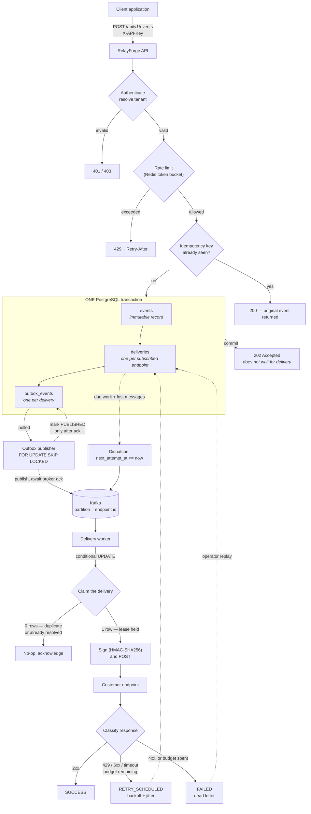
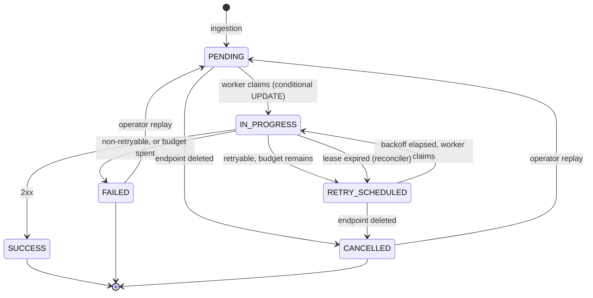
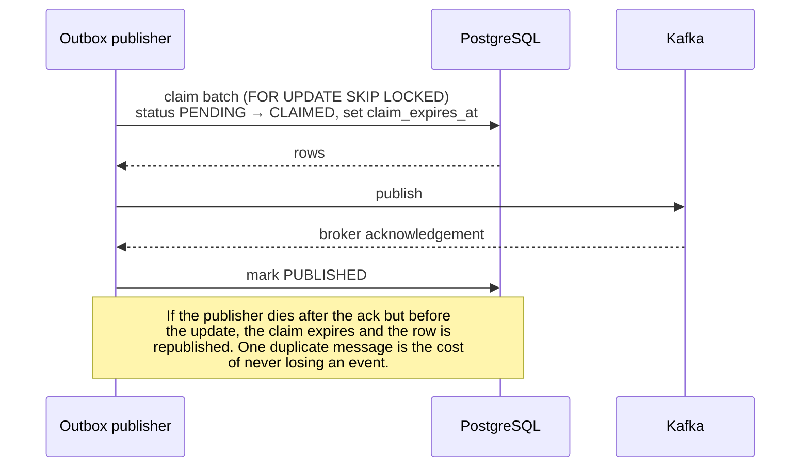

# Architecture

## The one-sentence version

PostgreSQL is the source of truth for what must be delivered; Kafka distributes
the work of delivering it. Kafka never decides whether a delivery still needs
doing — only which worker picks it up.

That distinction is the whole design. Everything below follows from it.

## Event flow

## Delivery state machine

`FAILED` *is* the dead-letter state. There is no separate `DEAD_LETTERED`
status and no second table: the dead-letter queue is a view over
`status = 'FAILED'`. One row per delivery means a replay cannot desynchronise
two representations of the same thing, and the attempt history stays attached
to what it explains.

`IN_PROGRESS` is the only state a crash can strand, which is why it is the only
one guarded by a lease.

## Components

| Component | Role | Scaling |
|---|---|---|
| **API** (`relayforge.role=api`) | Authentication, ingestion, all read paths. Writes to PostgreSQL only. | On request volume. |
| **Worker** (`relayforge.role=worker`) | Outbox publisher, dispatcher, Kafka consumer, HTTP delivery, lease reconciler. | On delivery volume. |
| **Webhook simulator** | Controlled fault injection for the Reliability Playground. Makes no outbound requests. | Single instance. |
| **Frontend** | Next.js dashboard. Holds the session cookie; the browser never calls the API directly. | Stateless. |

One artefact, three roles, selected by configuration. Splitting at configuration
time rather than build time keeps a single deployable while letting the two
dimensions that move independently — requests and deliveries — scale
separately.

## The transactional outbox

Ingestion must do two things: persist the event with its deliveries, and tell
the workers about it. Those live in two systems with no shared transaction.
Doing them in sequence is broken in both orders:

- **Commit, then publish.** The process dies in between and the event is
  accepted but silently never delivered. The caller has a 202 saying otherwise.
- **Publish, then commit.** The commit fails and workers chase a delivery row
  that does not exist.

The outbox removes the choice. The only write ingestion performs is to
PostgreSQL, so "accepted" and "queued for relay" become the same atomic fact.

The `CLAIMED` state with an expiry is what makes this safe. Without it, a
publisher that dies mid-flight leaves a row either lost forever or republished
forever. With it, the row is republished once — and the consumer is idempotent
precisely so that is affordable.

## Why retries are scheduled in the database, not in Kafka

Kafka has no per-message delay. The usual workarounds are a ladder of delay
topics or sleeping in a consumer. Both are wrong here:

- Delay topics quantise the schedule to whatever tiers exist, so a computed
  backoff of 7.3s becomes "the 10s topic" — and jitter, whose entire purpose is
  fine-grained spreading, stops working.
- Sleeping in a consumer holds a partition hostage, blocking every other
  delivery behind one endpoint's backoff.
- Neither lets a user see or correct a scheduled retry, and the UI has to show
  "next attempt in 2m 14s" from somewhere.

So `next_attempt_at` lives on the delivery row, where it is queryable and
displayable, and a dispatcher turns "due" into "queued". Kafka does what Kafka
is good at: fanning bounded work out to consumers.

The same query is the recovery path. Any due delivery whose `queued_at` is
older than the requeue grace is re-enqueued, which covers every way a message
can be lost — broker dropped it, publisher died after claiming, consumer
crashed before acknowledging.

## Concurrency

Three mechanisms, each doing one job:

| Mechanism | Protects against | Where |
|---|---|---|
| Conditional `UPDATE` on claim | Two workers delivering the same webhook | `DeliveryClaimDao.claim` |
| `FOR UPDATE SKIP LOCKED` | Two pollers claiming the same batch | outbox claim, dispatcher |
| Lease with expiry | A delivery stranded by a dead worker | `LeaseReconciler` |

The claim is the important one. A duplicate Kafka message updates zero rows and
costs one cheap statement — which is how at-least-once *messaging* becomes
effectively-once *processing*.

Demonstrated in `DeliveryClaimConcurrencyIT` with real threads against real
PostgreSQL: 32 workers racing for one delivery produce exactly one claim.

## Delivery semantics, stated plainly

**At-least-once.** Not exactly-once.

If a worker sends a request and dies before recording the result, there is no
way to know whether the receiver acted on it — that information was in the
response that was lost. RelayForge does not pretend otherwise:

- the attempt is counted, so a crash loop cannot escape the attempt budget;
- the delivery records that the outcome is genuinely unknown rather than
  inventing a failure;
- every request carries a stable `X-RelayForge-Event-Id` so receivers can
  deduplicate, which is the only place the ambiguity can actually be resolved.

Any platform promising exactly-once delivery of an external HTTP side effect is
promising something the network cannot provide.

## Data model

See [DATABASE_DESIGN.md](DATABASE_DESIGN.md) for the full schema, indexes and
the reasoning behind each.
